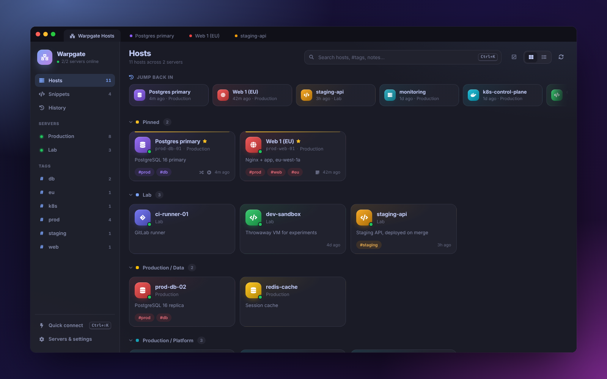
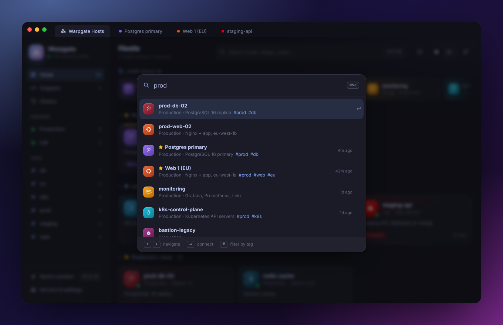
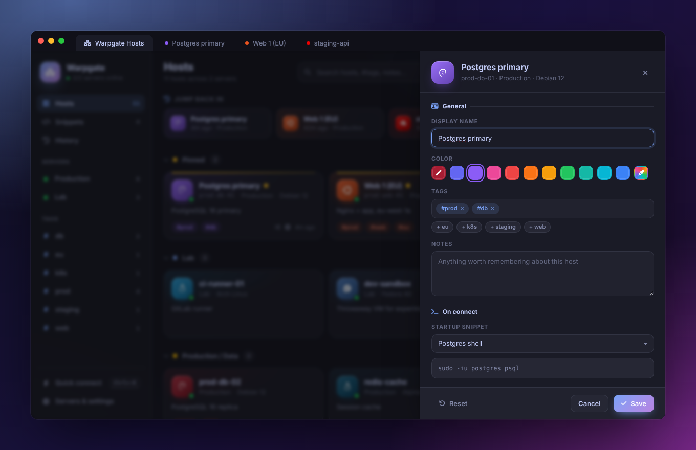
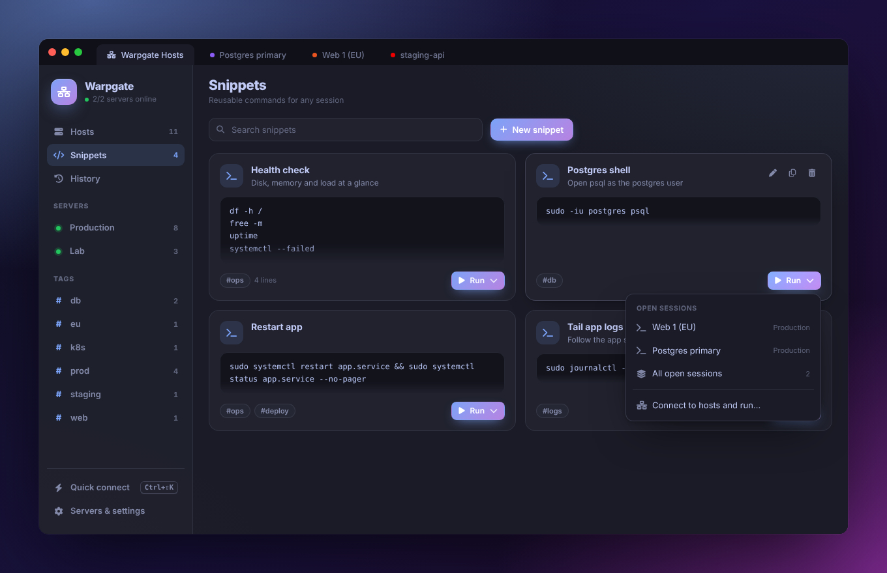
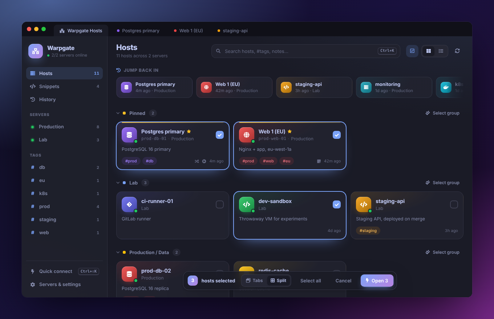
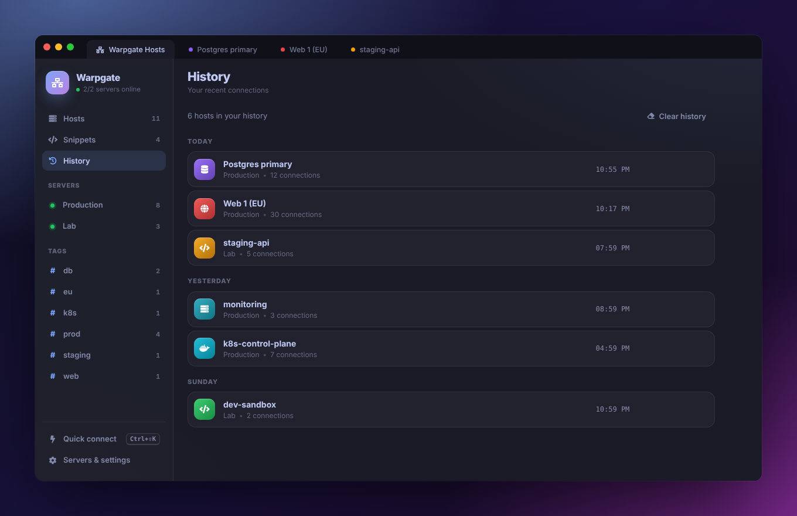
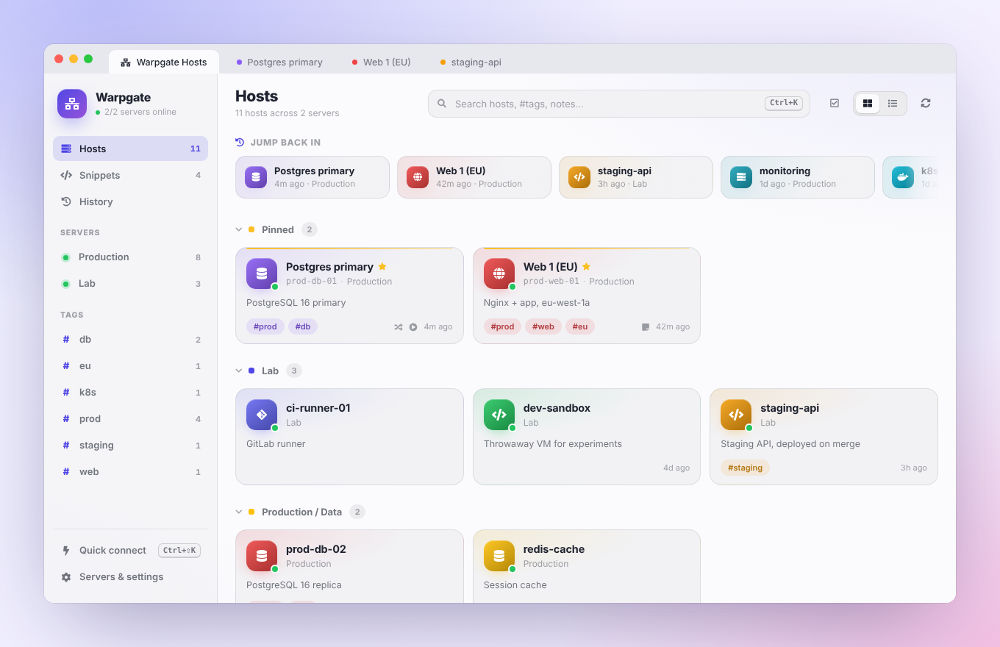
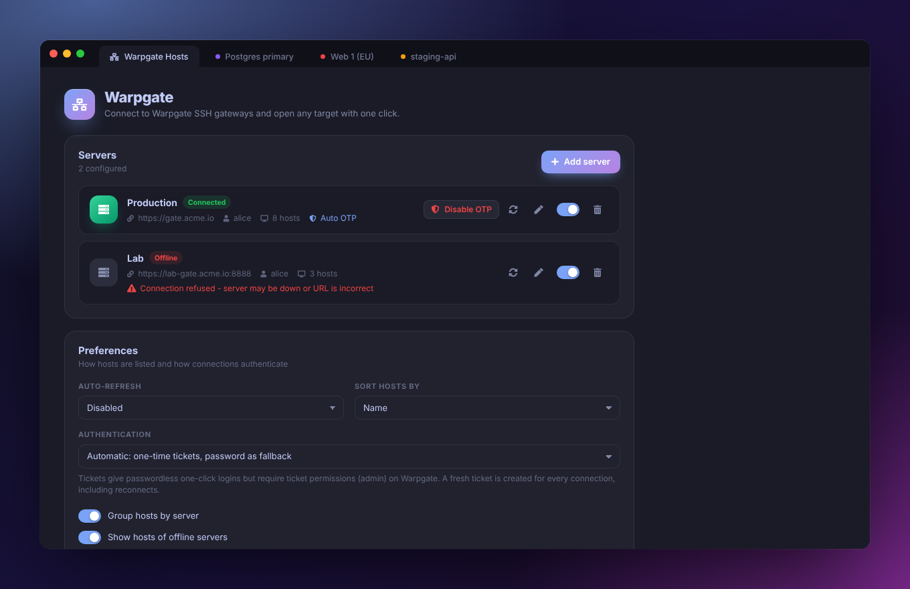

<div align="center">


# Tabby Warpgate

### The Warpgate SSH client for the Tabby terminal

**Every server behind your [Warpgate](https://github.com/warp-tech/warpgate) bastion, one click away in [Tabby](https://tabby.sh/).**<br>
No `user:target@host` strings. No passwords. No copying 2FA codes from your phone.

[](https://www.npmjs.com/package/tabby-warpgate)
[](https://www.npmjs.com/package/tabby-warpgate)
[](https://github.com/0x416c69/tabby-warpgate/actions/workflows/ci.yml)
[](https://github.com/0x416c69/tabby-warpgate/stargazers)
[](LICENSE)
[](CONTRIBUTING.md)

[**Install**](#-install) · [Features](#-features) · [Screenshots](#-screenshots) · [How it works](#-how-authentication-works) · [FAQ](#-faq) · [Contributing](#-contributing)

<br>



</div>

<br>

**Tabby Warpgate** is a free, open-source [Tabby](https://tabby.sh/) plugin that turns your [Warpgate](https://github.com/warp-tech/warpgate) account into a full **SSH host manager**. Every SSH target you can reach through the Warpgate bastion (jump host) shows up automatically. You connect with one click using single-use tickets, or with password and **automatic TOTP two-factor codes**. On top of that you get tags, notes, colors, a snippet library, connection history, port forwarding and multi-host sessions: the comfort of a paid SSH client like Termius, for teams that put their servers behind Warpgate.

## 💡 Why

Warpgate is a great SSH gateway: one entry point, per-user roles, session recording, 2FA. Using it from a terminal is less fun. Every host needs a username like `alice:prod-db-01`, the password goes in every time, and then you reach for your phone to type the one-time code.

| | Plain SSH profiles | **With Tabby Warpgate** |
|---|---|---|
| Adding hosts | Create a profile per target by hand | Every target you have access to appears automatically |
| Logging in | Password + OTP code on every connection | One click, with a single-use ticket |
| Reconnecting | Type everything again | A new ticket is created for you, also for duplicated, split and restored tabs |
| Finding a host | Scroll through a profile list | Fuzzy search by name, `#tag`, notes or server, from any tab |
| Repeated commands | Copy and paste | Snippet library, startup snippets, run on many hosts at once |
| Several gateways | Separate profile sets | Any number of Warpgate servers side by side |

**Made for** DevOps and SRE teams, platform engineers, MSPs and homelabbers who use Warpgate as their SSH bastion and Tabby as their terminal on Windows, macOS or Linux.

<br>

## ✨ Features

<table>
<tr>
<td width="50%" valign="top">

### ⚡ Connect

- **One-click SSH** to any Warpgate target with a fresh one-time ticket
- **Quick connect from anywhere** (<kbd>Ctrl</kbd>+<kbd>Shift</kbd>+<kbd>K</kbd>) with pinned and recent hosts first
- **Open many hosts at once** in tabs or a split grid
- **Reconnects that just work**: duplicate, split and restore tabs without a login prompt
- **Password + TOTP fallback**, 2FA codes answered automatically
- **Multiple Warpgate servers** at the same time

</td>
<td width="50%" valign="top">

### 🗂️ Organize

- **Aliases, tags, notes and colors** per host
- **Search** across names, descriptions, servers, groups, `#tags` and notes
- **Pinned hosts**, server and tag filters
- **Card and list layouts**, collapsible groups
- **"Jump back in"** row and a full connection history

</td>
</tr>
<tr>
<td width="50%" valign="top">

### 🧩 Automate

- **Snippet library**: run commands in one session, all sessions, or on hosts you pick
- **Startup snippets** that run as soon as the shell is ready
- **SSH port forwarding** per host: local, remote and dynamic (SOCKS proxy)
- **Agent forwarding, X11 and keepalive** per server, overridable per host

</td>
<td width="50%" valign="top">

### 🎨 Feels native

- Follows your Tabby color scheme: dark, light and custom themes
- Keyboard first: every action has a shortcut
- Auto-refresh of host lists and silent re-login when the web session expires
- Cleans up its own used tickets on the Warpgate server
- Windows, macOS and Linux

</td>
</tr>
</table>

<br>

## 📸 Screenshots

<table>
<tr>
<td width="50%">

<p align="center"><b>Quick connect</b><br><sub>Fuzzy search hosts, tags and notes. <kbd>Enter</kbd> connects.</sub></p>
</td>
<td width="50%">

<p align="center"><b>Make every host yours</b><br><sub>Alias, color, tags, notes, startup snippet, forwarding.</sub></p>
</td>
</tr>
<tr>
<td width="50%">

<p align="center"><b>Snippet library</b><br><sub>Run in one session, all of them, or connect and run.</sub></p>
</td>
<td width="50%">

<p align="center"><b>Open several hosts at once</b><br><sub>As tabs or in a split grid inside one tab.</sub></p>
</td>
</tr>
<tr>
<td width="50%">

<p align="center"><b>Connection history</b><br><sub>Pick up exactly where you left off.</sub></p>
</td>
<td width="50%">

<p align="center"><b>Follows your theme</b><br><sub>Colors come from your Tabby color scheme.</sub></p>
</td>
</tr>
<tr>
<td colspan="2">

<p align="center"><b>Servers and settings</b><br><sub>Status at a glance, one-click OTP setup, per-server SSH defaults.</sub></p>
</td>
</tr>
</table>

<br>

## 📦 Install

**From Tabby (recommended)**

1. Open **Settings → Plugins**
2. Search for **warpgate**
3. Click **Install** and restart Tabby

Tested with Tabby 1.0.238 and Warpgate 0.29.2.

<details>
<summary><b>Manual installation</b></summary>

```bash
git clone https://github.com/0x416c69/tabby-warpgate.git
cd tabby-warpgate
npm install
npm run build

# Then install it into Tabby's plugins directory:
#   Windows: %APPDATA%\tabby\plugins
#   macOS:   ~/Library/Application Support/tabby/plugins
#   Linux:   ~/.config/tabby/plugins
cd /path/to/tabby/plugins
npm install /path/to/tabby-warpgate
```

</details>

## 🚀 Connect to Warpgate in a minute

1. Open **Settings → Warpgate** and click **Add server**
2. Enter a name, the Warpgate web URL (e.g. `https://warpgate.example.com`), your username and password
3. Optional: paste your **OTP secret** so two-factor prompts are answered for you
4. Click **Test connection**, then **Add server**

That's it. Press <kbd>Ctrl</kbd>+<kbd>Shift</kbd>+<kbd>H</kbd> to open the hosts panel, or <kbd>Ctrl</kbd>+<kbd>Shift</kbd>+<kbd>K</kbd> from any tab to jump straight to a host. The SSH address and port are read from Warpgate, so there's nothing else to configure.

<br>

## 📖 Usage

<details>
<summary><b>Connecting to hosts</b></summary>

- **Hosts panel**: click the Warpgate button in the toolbar (or <kbd>Ctrl</kbd>+<kbd>Shift</kbd>+<kbd>H</kbd>) and click a host
- **Quick connect**: <kbd>Ctrl</kbd>+<kbd>Shift</kbd>+<kbd>K</kbd> anywhere in Tabby, type a few letters, <kbd>Enter</kbd>
- **In-panel search**: <kbd>Ctrl</kbd>+<kbd>K</kbd> while the hosts panel is focused
- **Tabby's profile selector**: Warpgate hosts are listed as profiles too and connect the same way

</details>

<details>
<summary><b>Opening several hosts at once</b></summary>

1. Click the **select** button in the hosts panel (or <kbd>Ctrl</kbd>-click a host)
2. Pick hosts, or use **Select group** / **Select all**
3. Choose **Tabs** or **Split** and click **Open**

In split mode the hosts are arranged in a grid inside one tab. Use Tabby's "Focus all panes" hotkey to type into all of them at once.

</details>

<details>
<summary><b>Customizing a host</b></summary>

Hover a host and click the settings button to open the host editor:

| Setting | Description |
|---------|-------------|
| **Display name** | Alias shown instead of the target name |
| **Color** | Accent color of the host card and tab |
| **Tags** | Free-form tags; filter with the sidebar or search with `#tag` |
| **Notes** | Anything worth remembering, searchable |
| **Startup snippet** | Snippet sent to the shell right after connecting |
| **Agent / X11 forwarding** | Server default, on or off |
| **Keepalive interval** | Seconds between keepalive packets |
| **Port forwarding** | Local, remote and dynamic (SOCKS) forwarding rules |

Port forwarding goes through Warpgate's SSH connection, so it only works for the forwarding types your Warpgate version supports.

</details>

<details>
<summary><b>Snippets</b></summary>

Open the **Snippets** section of the hosts panel to build a library of commands. Each snippet can be run:

- in an open Warpgate session, or in all open sessions at once
- on hosts you select: the plugin connects to them and runs the snippet when the shell starts
- in the current terminal with <kbd>Ctrl</kbd>+<kbd>Shift</kbd>+<kbd>J</kbd>
- automatically on connect, as a host's startup snippet

Multi-line snippets are sent line by line.

</details>

<details>
<summary><b>Keyboard shortcuts</b></summary>

| Shortcut | Action |
|----------|--------|
| <kbd>Ctrl</kbd>+<kbd>Shift</kbd>+<kbd>K</kbd> / <kbd>⌘</kbd>+<kbd>Shift</kbd>+<kbd>K</kbd> | Quick connect to a Warpgate host from anywhere |
| <kbd>Ctrl</kbd>+<kbd>Shift</kbd>+<kbd>J</kbd> / <kbd>⌘</kbd>+<kbd>Shift</kbd>+<kbd>J</kbd> | Run a snippet in the current terminal |
| <kbd>Ctrl</kbd>+<kbd>Shift</kbd>+<kbd>H</kbd> / <kbd>⌘</kbd>+<kbd>Shift</kbd>+<kbd>H</kbd> | Open the Warpgate hosts tab |
| <kbd>Ctrl</kbd>+<kbd>K</kbd> / <kbd>⌘</kbd>+<kbd>K</kbd> | Search inside the hosts panel (when the panel is focused) |
| <kbd>↑</kbd> <kbd>↓</kbd> / <kbd>Enter</kbd> / <kbd>Esc</kbd> | Navigate, connect, close |

All global shortcuts can be changed in **Settings → Hotkeys** ("Warpgate: …"). A "Refresh hosts" hotkey is available there too.

</details>

<details>
<summary><b>Configuration options</b></summary>

| Option | Description |
|--------|-------------|
| **Auto-refresh** | How often host lists are refreshed (disabled, 30s, 1m, 5m, 10m) |
| **Sort hosts by** | Name, recently used, server, group or type |
| **Authentication** | Automatic, tickets only or password only |
| **Group hosts by server** | Group by server and Warpgate group, or by Warpgate group only |
| **Show hosts of offline servers** | Keep showing hosts of servers that are currently unreachable |
| **Debug logging** | Detailed logs in the developer console (secrets are never logged) |
| **SSH defaults** (per server) | Agent forwarding, X11 forwarding and keepalive for all hosts of a server |

</details>

<br>

## 🔐 How authentication works

**One-time tickets (default).** For every SSH connection the plugin asks Warpgate for a single-use ticket for that target and logs in as `ticket-<secret>`, so no password prompt appears. Tickets expire after 10 minutes if unused, and reconnecting, duplicating, splitting or restoring a tab creates a new one right before connecting. Used and expired tickets created by the plugin are removed from the server during auto-refresh. Creating tickets requires ticket permissions (admin) on Warpgate.

**Password + OTP (fallback).** Without ticket permissions the plugin connects as `warpgate_user:target_name` with your stored password. When Warpgate asks for a one-time code, it is generated from your TOTP secret and sent automatically. Without an OTP secret, Tabby asks you for the code.

| Authentication mode | Behavior |
|------|----------|
| **Automatic** | Tickets when possible, password as fallback (one notice per server when tickets aren't permitted) |
| **Tickets only** | Never falls back; connecting fails with a clear error if no ticket can be created |
| **Password only** | Always password + OTP |

<details>
<summary><b>OTP setup, sessions and security</b></summary>

**OTP setup.** On a connected server in **Settings → Warpgate**, click **Set up OTP**. The plugin registers a new TOTP secret with your Warpgate account through the self-service API and stores it for automatic login. The secret is shown once so you can also add it to an authenticator app for the Warpgate web UI. **Disable OTP** removes it again. If OTP is already configured on your account, paste the existing secret into the server's **OTP secret** field instead.

**Sessions.** The plugin reuses its Warpgate web session and logs in again automatically when it expires, so ticket creation and host refreshes keep working.

**Security.** Passwords and OTP secrets are stored in Tabby's configuration file (`config.yaml`), like Tabby's own SSH passwords. Enable Tabby's **Vault** to encrypt them, and keep the file private.

</details>

<details>
<summary><b>Troubleshooting</b></summary>

| Problem | Solution |
|---------|----------|
| "Connection refused" | Check that Warpgate is running and the URL is correct |
| "Invalid credentials" | Verify username and password |
| "Additional authentication required (Sso)" | Your Warpgate policy requires a login method the plugin cannot automate (SSO, web approval) |
| "No hosts yet" | Make sure your Warpgate user has roles assigned to SSH targets |
| "Certificate error" | Enable "Trust self-signed certificates" for the server |
| "Tickets are not available" | Your account cannot create tickets; the password fallback is used |
| Port forward does not work | Check that your Warpgate version supports that forwarding type |

**Plugin not loading?**

1. Make sure the plugin was installed with npm (not just copied)
2. Check that it is listed in `plugins/package.json` in Tabby's config directory
3. Verify that `dist/index.js` exists
4. Open DevTools (<kbd>Ctrl</kbd>+<kbd>Shift</kbd>+<kbd>I</kbd>) and look for errors

Enable **Debug logging** in Settings → Warpgate for detailed logs in the developer console.

</details>

<br>

## ❓ FAQ

<details>
<summary><b>What is Warpgate?</b></summary>

[Warpgate](https://github.com/warp-tech/warpgate) is an open-source smart bastion host (jump host) for SSH, HTTPS, MySQL and PostgreSQL. It sits in front of your servers, handles authentication, 2FA and access roles, and records sessions, all without installing anything on the servers or the client.

</details>

<details>
<summary><b>What is Tabby?</b></summary>

[Tabby](https://tabby.sh/) (formerly Terminus) is a free, cross-platform terminal emulator and SSH client for Windows, macOS and Linux with tabs, split panes, an SFTP browser and a plugin system.

</details>

<details>
<summary><b>How do I connect to Warpgate from Tabby?</b></summary>

Install this plugin, add your Warpgate server under **Settings → Warpgate**, and click any host. Without the plugin you would create an SSH profile per target with the username `warpgate_user:target_name` and type your password and OTP code on every login.

</details>

<details>
<summary><b>Is this a Termius alternative?</b></summary>

For servers behind Warpgate, yes. You get a host list with tags, notes and colors, quick connect, a snippet library, connection history, port forwarding and multi-host sessions, all free and open source, inside a terminal you already use.

</details>

<details>
<summary><b>Do I need to be a Warpgate admin?</b></summary>

No. One-click ticket logins need ticket permissions, but without them the plugin logs in with your password and answers the 2FA prompt for you.

</details>

<details>
<summary><b>Does it work with Warpgate 2FA / OTP?</b></summary>

Yes. Store your TOTP secret and codes are generated and entered automatically, or let the plugin set up OTP on your account with one click.

</details>

<details>
<summary><b>Is it free?</b></summary>

Yes, it's MIT licensed. No account, no subscription, no telemetry.

</details>

<br>

## 🗺️ Roadmap

Ideas we'd love help with. Open an issue if you want to pick one up or have a better idea:

- [ ] HTTP targets: open Warpgate web targets in the browser with one click
- [ ] Database targets (MySQL / PostgreSQL) through a local tunnel
- [ ] SSO and web-approval logins
- [ ] Import and export of host settings and snippets
- [ ] Snippet variables (prompted placeholders like `{{service}}`)
- [ ] Tabby Web support

<br>

## 🤝 Contributing

Contributions of every size are welcome: bug reports, ideas, docs, translations, code. **We're also looking for co-maintainers.** If you use Warpgate every day and want to help shape this plugin, [open an issue](https://github.com/0x416c69/tabby-warpgate/issues/new/choose) and say hi.

```bash
git clone https://github.com/0x416c69/tabby-warpgate.git
cd tabby-warpgate
npm install
npm run watch     # rebuild on change
npm test          # unit tests
npm run lint
```

Run Tabby with your local build:

```bash
# Linux / macOS (run from the plugin folder)
TABBY_PLUGINS=$(dirname $(pwd)) tabby --debug

# Windows PowerShell
$env:TABBY_PLUGINS = (Get-Item .).Parent.FullName; tabby --debug
```

See [CONTRIBUTING.md](CONTRIBUTING.md) for the project layout and guidelines, and [TESTING.md](TESTING.md) for the test setup.

<details>
<summary><b>Using the plugin from another plugin</b></summary>

```typescript
import {
  WarpgateService,
  WarpgateApiClient,
  WarpgateProfileProvider,
  WarpgateConnectionService,
  WarpgateSnippetsService,
  WarpgateHostSettingsService,
  WarpgateHistoryService,
  WarpgateServerConfig,
  WarpgateTarget,
} from 'tabby-warpgate';
```

</details>

<br>

## ⭐ Star history

If this plugin saves you a few logins a day, a star helps other Warpgate users find it.

<a href="https://star-history.com/#0x416c69/tabby-warpgate&Date">
  <picture>
    <source media="(prefers-color-scheme: dark)" srcset="https://api.star-history.com/svg?repos=0x416c69/tabby-warpgate&type=Date&theme=dark">
    
  </picture>
</a>

## Credits

- [Tabby](https://tabby.sh/), the terminal this plugin lives in
- [Warpgate](https://github.com/warp-tech/warpgate), the smart SSH bastion that makes it possible

## License

[MIT](LICENSE)
