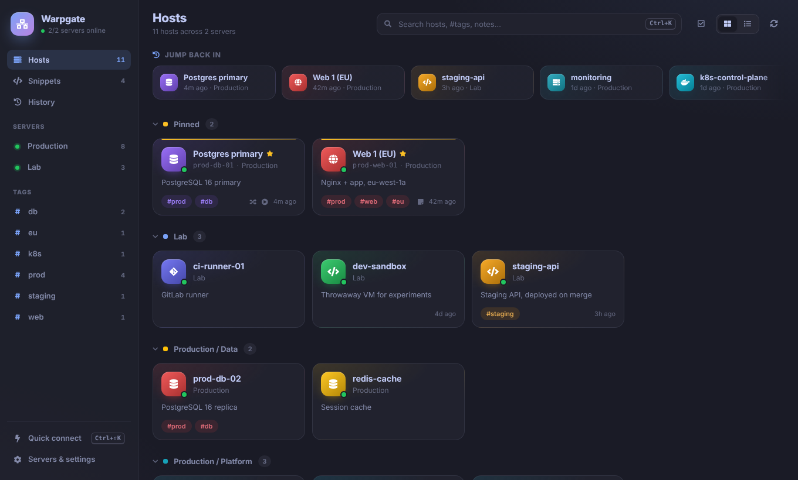

# Tabby Warpgate Plugin

[](https://www.npmjs.com/package/tabby-warpgate)
[](https://opensource.org/licenses/MIT)

A complete [Warpgate](https://github.com/warp-tech/warpgate) SSH gateway integration for [Tabby Terminal](https://tabby.sh/). Every SSH target you can reach through Warpgate shows up in one place and opens with a single click: no passwords, no `user:target@host` strings, no copying OTP codes.



## Features

**Connecting**

- **One-click SSH** to any Warpgate target, authenticated with a fresh one-time ticket
- **Quick connect from anywhere** (<kbd>Ctrl</kbd>+<kbd>Shift</kbd>+<kbd>K</kbd>) with pinned and recently used hosts first
- **Open several hosts at once**, as separate tabs or side by side in a split layout
- **Reliable reconnects**: reconnecting, duplicating, splitting and restoring tabs gets a new ticket automatically
- **Automatic password and OTP** answers when tickets are not available
- **Multiple Warpgate servers** at the same time

**Organizing**

- **Per-host aliases, tags, notes and colors**
- **Search** across names, descriptions, servers, groups, tags (`#prod`) and notes
- **Pinned hosts**, server and tag filters, card and list layouts
- **Connection history** with a "Jump back in" strip and a timeline of recent sessions

**Automating**

- **Snippet library**: save commands and run them in an open session, in all open sessions, or on hosts you pick
- **Startup snippets** that run automatically when you connect to a host
- **Port forwarding** rules per host (local, remote and dynamic/SOCKS)
- **Agent forwarding, X11 forwarding and keepalive** per server, overridable per host

**Everything else**

- Polished UI that follows your Tabby color scheme (dark, light and custom themes)
- Auto-refresh of host lists, automatic re-login when the Warpgate web session expires
- One-time ticket cleanup on the Warpgate server
- Works on Tabby Desktop (Windows, macOS, Linux)

## Installation

### From Plugin Manager (Recommended)

1. Open Tabby
2. Go to **Settings → Plugins**
3. Search for "warpgate"
4. Click **Install**

### Manual Installation

```bash
# Clone the repository
git clone https://github.com/0x416c69/tabby-warpgate.git
cd tabby-warpgate

# Install dependencies and build
npm install
npm run build

# Install to Tabby's plugins directory
# Windows: %APPDATA%\tabby\plugins
# macOS: ~/Library/Application Support/tabby/plugins
# Linux: ~/.config/tabby/plugins

cd /path/to/tabby/plugins
npm install /path/to/tabby-warpgate
```

## Quick Start

### Adding a Warpgate Server

1. Open **Settings → Warpgate**
2. Click **Add server** and fill in:
   - **Name**: a friendly name
   - **URL**: the Warpgate web URL, e.g. `https://warpgate.example.com`
   - **Username** and **Password** of your Warpgate account
   - **OTP secret** (optional): your TOTP secret, so two-factor prompts are answered automatically
3. Click **Test connection**. If Warpgate asks for a one-time code, enter it and test again
4. Click **Add server**

The SSH address and port are detected from Warpgate automatically.

### Connecting to Hosts

- **Hosts panel**: click the Warpgate button in the toolbar (or press <kbd>Ctrl</kbd>+<kbd>Shift</kbd>+<kbd>H</kbd>), then click any host
- **Quick connect**: press <kbd>Ctrl</kbd>+<kbd>Shift</kbd>+<kbd>K</kbd> anywhere in Tabby, type a few letters, press <kbd>Enter</kbd>
- **In-panel search**: press <kbd>Ctrl</kbd>+<kbd>K</kbd> while the hosts panel is focused
- **Tabby's profile selector**: Warpgate hosts are listed as profiles too and connect the same way

### Opening Several Hosts at Once

1. Click the **select** button in the hosts panel (or <kbd>Ctrl</kbd>-click a host)
2. Pick hosts, or use **Select group** / **Select all**
3. Choose **Tabs** or **Split** and click **Open**

In split mode the hosts are arranged in a grid inside one tab. Use Tabby's "Focus all panes" hotkey to type into all of them at once.

### Customizing a Host

Hover a host and click the settings button to open the host editor:

| Setting | Description |
|---------|-------------|
| **Display name** | Alias shown instead of the target name |
| **Color** | Accent color of the host card and tab |
| **Tags** | Free-form tags; filter with the sidebar or search with `#tag` |
| **Notes** | Anything worth remembering, searchable |
| **Startup snippet** | Snippet sent to the shell right after connecting |
| **Agent / X11 forwarding** | Server default, on or off |
| **Keepalive interval** | Seconds between keepalive packets |
| **Port forwarding** | Local, remote and dynamic (SOCKS) forwarding rules |

Port forwarding goes through Warpgate's SSH connection, so it only works for the forwarding types your Warpgate version supports.

### Snippets

Open the **Snippets** section of the hosts panel to build a library of commands. Each snippet can be run:

- in an open Warpgate session, or in all open sessions at once
- on hosts you select: the plugin connects to them and runs the snippet when the shell starts
- in the current terminal with <kbd>Ctrl</kbd>+<kbd>Shift</kbd>+<kbd>J</kbd>
- automatically on connect, as a host's startup snippet

Multi-line snippets are sent line by line.

## How Authentication Works

### One-Time Tickets (default)

1. When you add a server, the plugin stores your credentials in Tabby's configuration and logs in to the Warpgate web API
2. For every SSH connection the plugin creates a **one-time ticket** for the target and uses `ticket-<secret>` as SSH username, so no password prompt appears
3. Tickets are single use and expire after 10 minutes if they are never used. Reconnecting, duplicating, splitting or restoring a tab creates a new ticket right before connecting
4. Used and expired tickets created by the plugin are cleaned up on the Warpgate server during auto-refresh

Creating tickets requires ticket permissions (admin) on Warpgate.

### Password + OTP (fallback)

If tickets are not available, the plugin connects with `warpgate_user:target_name` and your stored password. When Warpgate asks for a one-time code, the plugin generates it from your OTP secret and answers the prompt automatically. Without an OTP secret, Tabby asks you for the code.

The **Authentication** preference controls this:

| Mode | Behavior |
|------|----------|
| **Automatic** | Tickets when possible, password as fallback (shows one notice per server when tickets are not permitted) |
| **Tickets only** | Never falls back; connecting fails with a clear error if no ticket can be created |
| **Password only** | Always uses password + OTP |

### OTP Setup

On a connected server in **Settings → Warpgate**, click **Set up OTP**. The plugin registers a new TOTP secret with your Warpgate account (self-service API) and stores it for automatic login. The secret is shown once so you can add it to an authenticator app for logging in to the Warpgate web UI. **Disable OTP** removes it again.

If OTP is already configured on your account, paste the existing secret into the server's **OTP secret** field instead.

### Session Handling

The plugin reuses its Warpgate web session and logs in again automatically when the session expires (for example after Warpgate's session timeout), so ticket creation and host refreshes keep working.

### Security Note

Credentials (passwords and OTP secrets) are stored in Tabby's configuration file (`config.yaml`), like Tabby's own SSH passwords. Enable Tabby's **Vault** to encrypt them, keep the file private and do not share it.

## Configuration Options

| Option | Description |
|--------|-------------|
| **Auto-refresh** | How often host lists are refreshed (disabled, 30s, 1m, 5m, 10m) |
| **Sort hosts by** | Name, recently used, server, group or type |
| **Authentication** | Automatic, tickets only or password only |
| **Group hosts by server** | Group by server and Warpgate group, or by Warpgate group only |
| **Show hosts of offline servers** | Keep showing hosts of servers that are currently unreachable |
| **Debug logging** | Detailed logs in the developer console (secrets are never logged) |
| **SSH defaults** (per server) | Agent forwarding, X11 forwarding and keepalive for all hosts of a server |

## Keyboard Shortcuts

| Shortcut | Action |
|----------|--------|
| <kbd>Ctrl</kbd>+<kbd>Shift</kbd>+<kbd>K</kbd> / <kbd>⌘</kbd>+<kbd>Shift</kbd>+<kbd>K</kbd> | Quick connect to a Warpgate host from anywhere |
| <kbd>Ctrl</kbd>+<kbd>Shift</kbd>+<kbd>J</kbd> / <kbd>⌘</kbd>+<kbd>Shift</kbd>+<kbd>J</kbd> | Run a snippet in the current terminal |
| <kbd>Ctrl</kbd>+<kbd>Shift</kbd>+<kbd>H</kbd> / <kbd>⌘</kbd>+<kbd>Shift</kbd>+<kbd>H</kbd> | Open the Warpgate hosts tab |
| <kbd>Ctrl</kbd>+<kbd>K</kbd> / <kbd>⌘</kbd>+<kbd>K</kbd> | Search inside the hosts panel (when the panel is focused) |
| <kbd>↑</kbd> <kbd>↓</kbd> / <kbd>Enter</kbd> / <kbd>Esc</kbd> | Navigate, connect, close |

All global shortcuts can be changed in **Settings → Hotkeys** ("Warpgate: …"). A "Refresh hosts" hotkey is available there too.

## Development

### Prerequisites

- Node.js 18+
- npm

### Setup

```bash
# Install dependencies
npm install

# Build
npm run build

# Watch mode (for development)
npm run watch

# Run tests
npm test

# Lint
npm run lint
```

### Project Structure

```
tabby-warpgate/
├── src/
│   ├── api/                 # Warpgate HTTP API client
│   ├── components/          # Angular components (hosts panel, editors, settings)
│   ├── models/              # TypeScript interfaces and defaults
│   ├── providers/           # Tabby providers (config, hotkeys, SSH tab handler, tab recovery)
│   ├── services/            # Services (servers, profiles, connections, host settings, snippets, history)
│   ├── utils/               # Utilities (TOTP, profile IDs, prompt detection)
│   ├── __tests__/           # Unit tests
│   └── index.ts             # Plugin entry point
├── dist/                    # Build output
├── package.json
├── tsconfig.json
├── webpack.config.js
└── jest.config.js
```

### Testing Your Plugin

```bash
# Run Tabby with your plugin in development
# The path should be the parent directory containing your plugin folder

# Windows PowerShell
$env:TABBY_PLUGINS = (Get-Item .).Parent.FullName; tabby --debug

# Linux/macOS
TABBY_PLUGINS=$(dirname $(pwd)) tabby --debug
```

## Troubleshooting

### Connection Issues

| Problem | Solution |
|---------|----------|
| "Connection refused" | Check that Warpgate is running and the URL is correct |
| "Invalid credentials" | Verify username and password |
| "Additional authentication required (Sso)" | Your Warpgate policy requires a login method the plugin cannot automate (SSO, web approval) |
| "No hosts yet" | Ensure your Warpgate user has roles assigned to SSH targets |
| "Certificate error" | Enable "Trust self-signed certificates" for the server |
| "Tickets are not available" | Your account cannot create tickets; the password fallback is used |
| Port forward does not work | Check that your Warpgate version supports that forwarding type |

### Plugin Not Loading

1. Ensure the plugin is installed via npm (not just copied)
2. Check `%APPDATA%\tabby\plugins\package.json` - the plugin should be listed
3. Verify `dist/index.js` exists
4. Open DevTools (Ctrl+Shift+I) and check for errors

### Debug Mode

Enable **Debug logging** in Settings → Warpgate to see detailed logs in the developer console.

## API Reference

The plugin exports classes that can be used by other plugins:

```typescript
import {
  WarpgateService,
  WarpgateApiClient,
  WarpgateProfileProvider,
  WarpgateConnectionService,
  WarpgateSnippetsService,
  WarpgateHostSettingsService,
  WarpgateHistoryService,
  WarpgateServerConfig,
  WarpgateTarget,
} from 'tabby-warpgate';
```

## Contributing

1. Fork the repository
2. Create a feature branch (`git checkout -b feature/amazing-feature`)
3. Make your changes
4. Run tests (`npm test`)
5. Commit your changes (`git commit -m 'Add amazing feature'`)
6. Push to the branch (`git push origin feature/amazing-feature`)
7. Open a Pull Request

## License

MIT License - see [LICENSE](LICENSE) file for details.

## Credits

- [Tabby Terminal](https://tabby.sh/) - The amazing terminal emulator
- [Warpgate](https://github.com/warp-tech/warpgate) - Smart SSH bastion host

## Support

- [GitHub Issues](https://github.com/0x416c69/tabby-warpgate/issues)
- [Tabby Discord](https://discord.gg/tabby)
